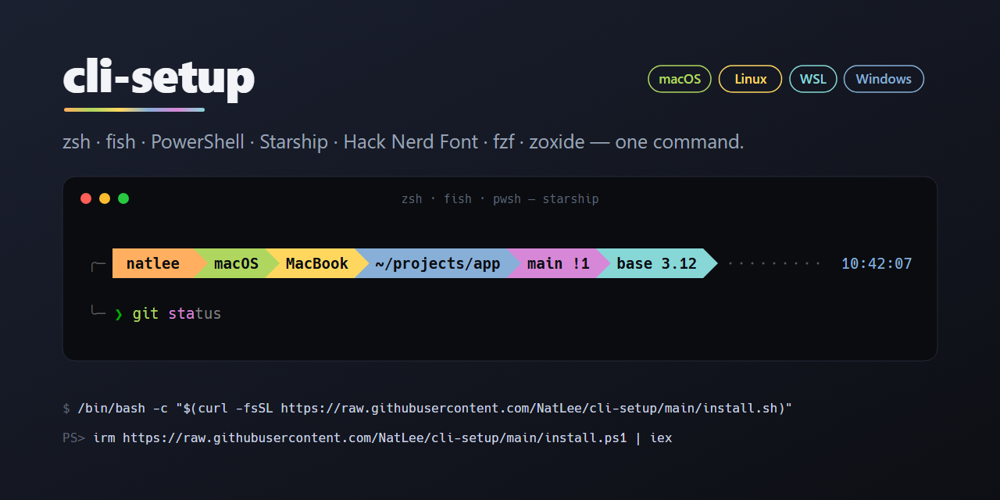

<p align="center">
  
</p>

<p align="center">
  一行指令，把終端機設定成 <b>zsh / fish + Starship</b> 的樣子，啟動只要約 <b>10–40 ms</b>。<br>
  支援 <b>macOS · Linux · WSL（zsh、fish）· Windows（PowerShell）</b>
</p>

---

## 🚀 一行安裝

**macOS / Linux / WSL**（在終端機貼上）：

```bash
/bin/bash -c "$(curl -fsSL https://raw.githubusercontent.com/NatLee/cli-setup/main/install.sh)"
```

**Windows**（在 PowerShell 貼上）：

```powershell
irm https://raw.githubusercontent.com/NatLee/cli-setup/main/install.ps1 | iex
```

執行後會先出現選單，可以挑選要裝的外掛和外觀，直接按 Enter 就是推薦設定。之後想改選項，再執行一次同一行指令就好，選單會記住你上次的選擇。

```
  Shell
   s 要設定的 shell  zsh          按 s 切換：zsh → fish → zsh + fish

  外掛 / 工具
   1 [x] ★ fzf-tab                    Tab 補完改成 fzf 模糊搜尋選單
   2 [x] ★ history-substring-search   ↑/↓ 依目前已輸入的內容搜尋歷史
   3 [ ]   you-should-use             打了完整指令時，提醒你有對應的 alias（僅 zsh）
   4 [x] ★ zoxide                     z <關鍵字> 直接跳到常去的目錄
   5 [x] ★ fzf                        Ctrl-R 搜歷史 · Ctrl-T 找檔案 · Alt-C 跳目錄
   6 [ ]   eza                        ls / l / ll / la / lt 換成彩色 + 圖示的 eza
   7 [x] ★ aliases                    常用 alias：ll = ls -lah、..、gst / gco 等 git 縮寫

  外觀
   8 建議文字顏色    中 (244)     預覽：git status --short
   9 語法高亮主題    soft         預覽：git commit -m "fix" ~/src
  10 Prompt 時間     開
  11 Prompt IP       開

  其他
   c 安裝 Miniconda       關  沒有偵測到 conda；開啟後裝到 ~/miniconda3，並套用下面的載入方式   ← 只有沒裝 conda 時
  12 Conda 載入方式  fast         快取 hook，瞬間啟用 base（推薦）
  13 安裝 Hack Nerd Font  開
  14 設定 Terminal.app  開  Home/End 鍵送給 shell、字型換成 Hack Nerd Font Mono   ← 只有 macOS

  ★ 推薦  輸入編號切換（可一次多個，例如 1 8 9），直接 Enter 開始安裝，q 離開
  >
```

## 🖥️ 支援的平台

| 平台 | 安裝方式 | 已實際測試 |
| --- | --- | --- |
| macOS（Apple Silicon / Intel） | Homebrew | macOS 27 |
| Ubuntu / Debian | apt | Ubuntu 22.04、24.04，Debian 12 |
| Fedora | dnf | Fedora 42 |
| Arch Linux | pacman | Arch（rolling） |
| openSUSE | zypper | Tumbleweed |
| WSL | 同 Linux | — |
| Windows 10 / 11 | winget（或 Scoop）+ PowerShell Gallery | Windows 11（PowerShell 7.6，文件資料夾導向 Synology Drive）實機 |

Linux 上如果套件管理器沒有某個工具，或版本太舊（例如 Ubuntu 22.04 的 fzf 不支援 `fzf --zsh`），會自動改從官方來源安裝到 `~/.local/bin`，不會動到系統。

> Windows 沒有原生的 zsh / fish，所以用 PowerShell 做出一樣的體驗：同一份 Starship 設定、同樣的配色、同樣的 alias。想在 Windows 用真正的 zsh 或 fish，請在 **WSL** 裡執行上面的 Linux 指令。

### zsh 還是 fish？

macOS / Linux / WSL 可以選 **zsh**、**fish**，或兩個都設定：在選單裡按 `s` 切換，或用 `--shell=zsh|fish|both` 指定。第一次安裝時，登入 shell 已經是 fish 就預設選 fish，否則選 zsh。

- 登入 shell 如果已經是你選的其中一個，就不會去動它；否則會用 `chsh` 換成你選的那個（兩個都選時是 zsh）。
- fish 的設定放在 `~/.config/fish/conf.d/cli-setup.fish`，**不會動到你自己的 `config.fish`**。如果 `config.fish` 裡原本就有 `starship init`、`zoxide init`、`conda initialize` 之類的段落，安裝時會提醒你刪掉，以免載入兩次。
- fish 建議 3.4 以上（已在 3.3、3.7、4.2 測試）。Ubuntu 22.04 內建的 3.3 也能用，只是新版 fzf 的 Ctrl-R / Ctrl-T / Alt-C 整合需要 3.4 以上，安裝時會提示升級方式。

## 🧩 功能

| 功能 | zsh | fish | Windows（PowerShell） |
| --- | --- | --- | --- |
| 灰字自動建議 | [zsh-autosuggestions](https://github.com/zsh-users/zsh-autosuggestions) | 內建 | PSReadLine 歷史預測（InlineView） |
| 語法高亮 | [fast-syntax-highlighting](https://github.com/zdharma-continuum/fast-syntax-highlighting) + soft / minimal 主題 | 內建，同樣的 soft / minimal 主題 | PSReadLine 配色，同樣的 soft / minimal 主題 |
| 補完 | [zsh-completions](https://github.com/zsh-users/zsh-completions) | 內建 | PowerShell 內建 |
| ★ Tab 模糊選單 | [fzf-tab](https://github.com/Aloxaf/fzf-tab) | 內附的 fzf 選單（候選超過一個時出現） | [PSFzf](https://github.com/kelleyma49/PSFzf) |
| ★ ↑/↓ 依輸入搜尋歷史 | [zsh-history-substring-search](https://github.com/zsh-users/zsh-history-substring-search) | 內建 | PSReadLine HistorySearchBackward |
| ★ Ctrl-R / Ctrl-T / Alt-C | [fzf](https://github.com/junegunn/fzf) | fzf | fzf + PSFzf |
| ★ `z` 智慧跳目錄 | [zoxide](https://github.com/ajeetdsouza/zoxide) | zoxide | zoxide |
| `ls` 彩色 + 圖示 | [eza](https://github.com/eza-community/eza) | eza | eza |
| ★ 常用 alias | `aliases.zsh` | `aliases.fish`（名稱相同） | `aliases.ps1`（名稱相同） |
| 提醒你有 alias 可用 | [zsh-you-should-use](https://github.com/MichaelAquilina/zsh-you-should-use) | — | — |
| Prompt | [Starship](https://starship.rs)（同一份 `starship.toml`） | Starship | Starship |
| 字型 | [Hack Nerd Font](https://www.nerdfonts.com) | Hack Nerd Font | Hack Nerd Font（裝在目前使用者，不需要系統管理員） |
| Conda | fast：不啟動 Python 直接啟用 base | fast：同 zsh | defer：背景啟用 base，提示字元立刻出現 |
| 終端機自動設定 | Terminal.app：Home/End + 字型 | 同 zsh | Windows Terminal：字型 |
| 編輯按鍵 | Emacs（`bindkey -e`） | Emacs（fish 預設） | Emacs（可改成 Windows） |

★ 為預設開啟。fish 把自動建議、語法高亮、補完、歷史搜尋都做成內建功能，所以不需要另外下載外掛；它的語法高亮沒有「子指令」這個分類，所以 `git commit` 的 `commit` 會是一般文字的顏色。

## ⌨️ 常用 alias

git 的縮寫和 Oh My Zsh 用一樣的名稱，從 Oh My Zsh 換過來不用重新記；如果開啟了 eza，`l` / `ll` / `la` 會自動換成 eza 版本。

| 分類 | alias |
| --- | --- |
| 目錄 | `..` → `cd ..` · `...` → `cd ../..` · `....` · `-` → `cd -`（zsh、fish） |
| 列出檔案 | `l` → `ls -lh` · `ll` → `ls -lah` · `la` → `ls -A` |
| 常用預設 | `mkdir` → `mkdir -p` · `grep` 有顏色 · `df` / `du` 易讀單位 · `h` 最近 20 筆歷史 |
| git | `g` · `gst` status · `gss` 簡短 status · `ga` / `gaa` add · `gc` commit · `gcmsg` commit -m · `gd` / `gds` diff · `gco` checkout · `gsw` switch · `gb` branch · `gl` pull · `gp` push · `glog` 圖形化 log · `gsta` / `gstp` stash |
| 系統 | `o` 用檔案總管打開目前目錄 · `path` 逐行列出 PATH（fish 除外） · `localip` 本機 IP · `ports` 哪個程式在監聽哪個 port · `flushdns` 清除 DNS 快取 · `reload` 重啟 shell（zsh、fish） |
| Windows 額外 | `which` · `touch` |

fish 版用函式做出同樣的名稱（`-` 是縮寫，按空白鍵或 Enter 時展開成 `cd -`）。`path` 在 fish 是內建指令，fish 自己的函式也會用到，所以不覆蓋它。

Windows 版會移除 PowerShell 內建、名稱衝突的 `gc`（Get-Content）、`gp`、`gl` alias。

## ⌨️ Home / End 鍵

- **zsh**：綁定各家終端機送出的 Home / End / Delete 按鍵序列，以及 Ctrl / Option + ←/→ 一次跳一個單字。
- **fish**：Home / End、Ctrl / Option + ←/→ 都是內建的，不需要額外設定。
- **macOS Terminal.app**：預設把 Home / End 拿去捲動視窗，按鍵根本不會送進 shell。選單第 14 項會把預設描述檔的 Home / End 改成送給 shell，順便把字型換成 Hack Nerd Font Mono（大小不變），改之前會先備份原本的 Terminal 設定。要**完全結束 Terminal.app（⌘Q）再重新打開**才會生效；想捲動視窗內容時改用 `Shift + Home / End`。
- **Windows Terminal / PowerShell**：Home / End 原本就能用。

## 🎨 外觀

```
╭─ natlee  macOS  MacBook  ~/projects/app  main !1  base 3.12 ············ 10:42:07
╰─❯ git sta░tus░
```

- **Prompt 分段**：使用者 → 作業系統 → 主機名稱 → 目錄 → Git 分支／狀態 → Conda 環境／Python 版本；右側顯示時間和 IP，都可以在選單關掉
- **自動建議文字**：灰色，暗 `240`、中 `244`、亮 `248`，也可以用參數指定 0–255
- **語法高亮主題**：

  | 主題 | 風格 |
  | --- | --- |
  | `soft`（預設） | 柔和的粉彩色，和 Starship 配色一致；沒有背景色塊，也不加粗 |
  | `minimal` | 幾乎是單色，只有路徑、字串和錯誤會帶一點顏色 |
  | `default` | 外掛原本的高對比配色 |

## ⚡ 啟動速度

| | 啟動時間 |
| --- | --- |
| 一般的 `conda init` + 外掛（macOS） | ~280 ms |
| **cli-setup（macOS）** | **~40 ms** |
| **cli-setup（Linux）** | **~20 ms** |
| **cli-setup（fish，Linux）** | **~10 ms** |
| 原本的 PowerShell 可攜設定（Windows 11 實機） | ~1.4 s |
| **cli-setup（PowerShell 7 設定檔）** | **~0.3 s**（不含 PowerShell 本身的啟動時間） |

變快的原因：

- **快取初始化腳本**：`brew shellenv`、`starship init`、`fzf --zsh` / `fzf --fish`、`zoxide init`、conda hook 的輸出存在快取資料夾，對應的程式更新後才重新產生
- **Conda fast 模式**（zsh、fish）：不另外啟動 Python 就直接啟用 base 環境，結果和官方 `conda activate` 完全相同；base 有 activate.d 腳本或環境變數時，自動改走官方流程
- **`compinit` 每天只完整檢查一次**，其他時候直接讀快取並編譯成 `.zwc`；Debian / Ubuntu 會設定 `skip_global_compinit=1`，避免系統再跑一次
- **zsh-autosuggestions** 開啟 `USE_ASYNC` 和 `MANUAL_REBIND`
- **fish** 本來就不需要外掛，設定檔只做快取載入；alias 直接寫成函式，省掉 `alias` 指令逐一建立的時間

手動安裝或更新了工具後，如果行為怪怪的，執行 `zsh-cache-clear` 再重開終端機即可（zsh 和 PowerShell 都有；fish 是 `fish-cache-clear`）。

**要不要裝 Miniconda 由你決定**：預設不安裝。

- 已經有 conda（Miniconda、Anaconda、Miniforge、Mambaforge 都會偵測）時，直接套用下面的載入方式。
- 沒有 conda 時，選單會多出 `c 安裝 Miniconda`，或用 `--miniconda=on` / `-Miniconda on` 指定。開啟後，安裝程式會用官方安裝檔把 Miniconda 裝到 `~/miniconda3`（Windows 是 `%USERPROFILE%\miniconda3`），裝完一樣套用下面的優化。
- 安裝時不會執行 `conda init`，也不會改 PATH 或登錄檔，conda 由 cli-setup 的設定檔負責載入。
- Miniconda 預設使用 Anaconda 的 defaults channel：第一次安裝套件時 conda 可能會請你同意服務條款，200 人以上的組織使用需要商業授權。不想受這些限制的話，可以自己裝 [Miniforge](https://github.com/conda-forge/miniforge)（預設 conda-forge），cli-setup 一樣會偵測到。

| Conda 模式 | 說明 |
| --- | --- |
| `defer`（Windows 預設） | 提示字元立刻出現，base 在背景準備好、命令列空閒時才套用（約 1 秒內）。期間自己打 `conda` 或改了環境變數會自動取消；`$CondaBaseStartup.Status` 可查看狀態。腳本與 `pwsh -Command` 仍會同步啟用 base |
| `fast`（macOS / Linux 預設） | zsh / fish：不啟動 Python 直接啟用 base；PowerShell：直接載入 Conda 模組並立刻啟用 base |
| `lazy` | 第一次打 `conda` 時才載入，最快，但開新終端機時 base 不會自動啟用 |
| `full` | 官方 `conda init` 的行為 |
| `off` | 不載入 conda |

PowerShell 版其他加速：PSFzf（約 200 ms）改成第一次按 Ctrl-R / Ctrl-T / Alt-C / Tab 時才載入；Conda 直接載入 `Conda.psm1`，不必先執行一次 `conda.exe` 產生 hook；腳本與 `-Command` 啟動時跳過提示字元與按鍵設定。

## 🔤 字型

提示字元裡的圖示（󰊢、󰌠、󰀵…）需要 Nerd Font 才能正常顯示。字型要裝在**你打字的那台電腦**上：透過 SSH 連到伺服器時，裝在本機；用 WSL 時，裝在 Windows 端（執行 `install.ps1`）。所以在沒有桌面環境的 Linux 和 WSL 上，選單預設不安裝字型。

| 終端機 | 設定方式 |
| --- | --- |
| Terminal.app | 選單第 14 項自動設定，或：設定 → 描述檔 → 文字 → 字體 |
| iTerm2 | Settings → Profiles → Text → Font |
| Windows Terminal | `install.ps1` 自動設定，或：設定 → 預設值 → 外觀 → 字體 |
| GNOME Terminal / Konsole | 偏好設定 → 描述檔 → 自訂字型 |
| VS Code | `"terminal.integrated.fontFamily": "Hack Nerd Font Mono"` |

## 🧰 參數

不想看選單時可以直接用參數，加上 `-y` / `-Yes` 就完全不會詢問。

**install.sh**

```bash
/bin/bash -c "$(curl -fsSL https://raw.githubusercontent.com/NatLee/cli-setup/main/install.sh)" -- \
  -y --plugins=fzf-tab,zoxide,fzf,aliases --theme=minimal --suggest-color=dim --ip=off
```

| 參數 | 說明 |
| --- | --- |
| `-y`, `--yes` | 不顯示選單，使用預設值（或上次安裝時的選擇） |
| `--shell=` | `zsh` / `fish` / `both`（預設：登入 shell 是 fish 就選 fish，否則 zsh） |
| `--plugins=a,b,c` | `fzf-tab` `history-substring-search` `you-should-use` `zoxide` `fzf` `eza` `aliases`；`none` / `all` |
| `--suggest-color=` | `dim` / `medium` / `bright`，或 `0`–`255` |
| `--theme=` | `soft` / `minimal` / `default` |
| `--time=on\|off` · `--ip=on\|off` | Prompt 是否顯示時間 / IP |
| `--conda=` | `fast` / `lazy` / `full` / `off` |
| `--miniconda=on\|off` | 沒有 conda 時安裝 Miniconda 到 `~/miniconda3`（預設 off；已有 conda 時忽略） |
| `--font=on\|off` | 是否安裝 Hack Nerd Font（`--no-font` 同 `--font=off`） |
| `--terminal-app=on\|off` | macOS：是否設定 Terminal.app |
| `--skip-packages` | 不安裝任何套件（需要已經有 `zsh` / `fish`、`git`、`starship`） |

**install.ps1**

```powershell
& ([scriptblock]::Create((irm https://raw.githubusercontent.com/NatLee/cli-setup/main/install.ps1))) -Yes -Theme minimal -Ip off
```

| 參數 | 說明 |
| --- | --- |
| `-Yes` | 不顯示選單 |
| `-Plugins a,b,c` | `fzf-tab` `history-substring-search` `zoxide` `fzf` `eza` `aliases`；`none` / `all` |
| `-SuggestColor` · `-Theme` | 同上 |
| `-Conda` | `defer`（預設）/ `fast` / `lazy` / `full` / `off` |
| `-Miniconda on\|off` | 沒有 conda 時安裝 Miniconda 到 `%USERPROFILE%\miniconda3`（預設 off；已有 conda 時忽略） |
| `-EditMode Emacs\|Windows` | PSReadLine 編輯模式，預設 Emacs（和 zsh 一樣的按鍵） |
| `-WindowsPowerShell on\|off` | Windows PowerShell 5.1 是否也套用（有 PowerShell 7 時預設 off；開啟時才會調整 5.1 的執行原則） |
| `-ReplaceProfile` | 把原本的 `profile.ps1`、`Microsoft.PowerShell_profile.ps1` 移到同一個資料夾裡的 `backup-before-cli-setup-<時間>\`，由 cli-setup 接管 |
| `-Time on\|off` · `-Ip on\|off` · `-Font on\|off` | 同上 |
| `-WindowsTerminal on\|off` | 是否把 Windows Terminal 的預設字型改成 Hack Nerd Font Mono |
| `-SkipPackages` | 不安裝任何工具 / 模組 |

也可以 clone 下來再執行：`./install.sh`，或在 PowerShell 7 執行 `pwsh -File install.ps1`。

## 📁 安裝了哪些檔案

**macOS / Linux — zsh**

```
~/.zsh/
├── .zshrc            ← zsh 設定（config/zshrc）
├── options.zsh       ← 你在選單裡的選擇
├── aliases.zsh       ← 常用 alias
├── .zshrc.local      ← (選用) 你自己的設定，不會被覆蓋
├── .zsh_history      ← 第一次安裝時會複製原本的 ~/.zsh_history
├── themes/           ← 語法高亮主題
└── plugins/          ← zsh 外掛
~/.zshrc              → symlink 指向 ~/.zsh/.zshrc
~/.config/starship.toml
~/.cache/zsh/         ← 初始化快取，可以隨時刪除
~/.local/bin/         ← (Linux) 從官方來源安裝的工具
```

**macOS / Linux — fish**

```
~/.config/fish/
├── conf.d/cli-setup.fish   ← fish 設定（config/fish/cli-setup.fish），fish 啟動時自動載入
├── cli-setup/
│   ├── options.fish        ← 你在選單裡的選擇
│   ├── aliases.fish        ← 常用 alias
│   └── themes/             ← 語法高亮主題
└── config.fish             ← 你自己的設定，在 cli-setup 之後載入，不會被動到
~/.config/starship.toml
~/.cache/cli-setup/fish/    ← 初始化快取，可以隨時刪除
```

**Windows**

```
~\.config\cli-setup\                       ← 真正的設定都放在本機
├── profile.ps1       ← PowerShell 設定（config/windows/profile.ps1）
├── conda-defer.ps1   ← Conda 背景啟用
├── options.ps1       ← 你在選單裡的選擇
├── aliases.ps1       ← 常用 alias
└── local.ps1         ← (選用) 你自己的設定，不會被覆蓋
~\.config\starship.toml
<文件>\PowerShell\profile.ps1               ← 只加一小段載入程式碼（PowerShell 7）
<文件>\WindowsPowerShell\profile.ps1        ← 同上，只有選擇套用 5.1 時才會加
%LOCALAPPDATA%\cli-setup\cache\             ← 初始化快取
%LOCALAPPDATA%\cli-setup\Start-PowerShell-Local.cmd  ← 備援啟動器
```

`<文件>` 是 Windows 實際的「文件」資料夾。安裝程式會直接詢問每個 PowerShell 版本的 `$PROFILE` 位置，所以文件資料夾被導向 OneDrive、Synology Drive 或網路磁碟時也能放對地方：

- **同步資料夾裡只放一小段載入程式碼**，真正的設定放在本機的 `~\.config\cli-setup\`。其他同步的電腦還沒裝 cli-setup 時，只會顯示一行安裝提示，不會出錯。
- **同步資料夾暫時讀不到時**（離線、還沒同步完成），按 `Win + R` 執行 `%LOCALAPPDATA%\cli-setup\Start-PowerShell-Local.cmd`，直接載入本機的設定。
- 安裝時也會設定 `POWERSHELL_UPDATECHECK=Off`，關掉 PowerShell 7 的更新提示（部分中文環境會因此當掉）。

原本就有的設定檔，如果內容和新的不一樣，會先備份到 `~/.cli-setup-backup/<時間>/`，再寫入新的。

## ⚙️ 自訂

| 想改什麼 | 改哪裡 |
| --- | --- |
| 外掛、顏色、主題、conda 模式 | 重新執行安裝指令 |
| Prompt 的顏色、分段、格式 | `~/.config/starship.toml`，參考 [Starship 文件](https://starship.rs/config/) |
| 在 base 環境時隱藏 conda 那一格 | `starship.toml` 的 `[conda]` 改成 `ignore_base = true` |
| 自己的 alias、環境變數 | zsh：`~/.zsh/.zshrc.local`；fish：`~/.config/fish/config.fish`；PowerShell：`~\.config\cli-setup\local.ps1` |

> 重新執行安裝時會覆蓋 `starship.toml`，覆蓋前會先備份；如果你手動改過，記得從備份中把修改搬回來。

## ↩️ 還原

```bash
ls ~/.cli-setup-backup/                                   # 找到要還原的時間點
cp ~/.cli-setup-backup/<時間>/.zshrc ~/.zshrc
cp ~/.cli-setup-backup/<時間>/starship.toml ~/.config/starship.toml
defaults import com.apple.Terminal ~/.cli-setup-backup/<時間>/com.apple.Terminal.plist   # macOS：還原 Terminal.app
```

fish：刪除 `~/.config/fish/conf.d/cli-setup.fish` 和 `~/.config/fish/cli-setup/` 即可，`config.fish` 從頭到尾沒有被改過。登入 shell 要換回 zsh 的話：`chsh -s "$(command -v zsh)"`。

Windows：從 `~\.cli-setup-backup\<時間>\` 把檔案複製回去，並刪除 `<文件>\PowerShell\profile.ps1` 裡 `# >>> cli-setup >>>` 到 `# <<< cli-setup <<<` 那一段。用 `-ReplaceProfile` 安裝的話，原本的設定檔在 `<文件>\PowerShell\backup-before-cli-setup-<時間>\`，搬回原位即可。

## 📄 License

[MIT](LICENSE)
